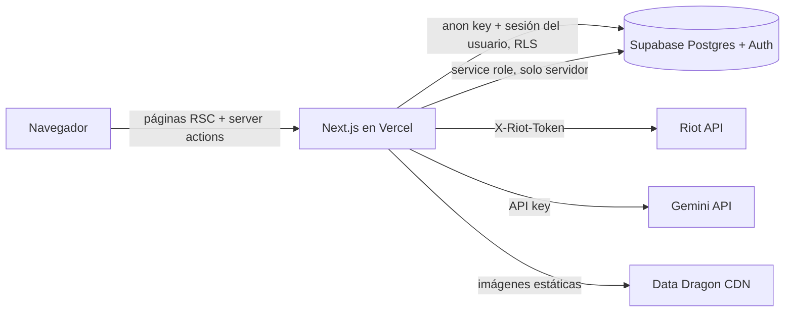

# Krakethon — Scouting verificado de League of Legends

**Identidad competitiva verificada para jugadores de LoL de LATAM.** Stats que salen de la API de Riot y nadie puede editar, más lo que los equipos necesitan para reclutar: roles, idiomas, horarios y contacto.

> KRANKETHON 2026 (Salta Gaming + IDEA) · Track 2: Economía Digital, UGC y Comunidad

<!-- TODO: captura principal o GIF corto del flujo (docs/capturas/flujo.gif) -->

## El problema
Los equipos amateur y semi-pro reclutan por Discord con capturas de op.gg que se pueden editar, sin saber si el jugador habla su idioma o si juega en su horario. Del otro lado, los jugadores buenos no tienen dónde mostrarse con datos que se puedan creer.

**Krakethon** une las dos cosas. El perfil del jugador tiene sus stats **verificadas** (vincula su cuenta y prueba que es suya) y sus datos **declarados**. Los equipos lo encuentran con filtros o escribiendo en lenguaje natural, y ven un porcentaje de compatibilidad explicado criterio por criterio.

## Demo
- **Deploy:** TODO: https://krakenthon2026.vercel.app/
- **Usuario reclutador de prueba:** `demo-equipos@krakethon.app` (la contraseña se entrega junto con la demo)
- Guion de la demo: [`docs/07-entrega.md`](docs/07-entrega.md)

## Funcionalidades
| | Qué hace |
|---|---|
| **Cuenta verificada** | Vinculás tu Riot ID y te ponés en el cliente de LoL un ícono que te pedimos al azar. Si coincide, la cuenta queda verificada. Una cuenta verificada no la puede reclamar nadie más. |
| **Perfil con stats verificadas** | Últimas 30 ranked Solo/Duo: winrate, KDA, CS/min, visión/min, kill participation, campeones, roles, forma reciente y comparación con el rango. Ningún usuario puede editarlas. |
| **Disponibilidad** | Roles, idiomas, país, bio, horarios con zona horaria (el que mira los ve convertidos a su zona) y contacto con visibilidad (público, solo equipos u oculto). |
| **Informe de scouting IA** | Gemini resume fortalezas, debilidades, campeones y rol recomendado, usando solo las stats verificadas. |
| **Equipos** | Crear, editar y gestionar miembros (dueño, reclutador, jugador). |
| **Buscador** | Filtros por rol, rango, idioma, país, verificados, "buscando equipo" y franja horaria, guardados en la URL. |
| **Búsqueda en lenguaje natural** | "busco support Esmeralda+ que hable español y juegue de noche" → chips editables ("Entendí: Support ✕ · Esmeralda+ ✕ ..."). |
| **Compatibilidad jugador-equipo** | 0-100% con el desglose por rol, rango, idioma y horario. |
| **Torneos** | Roadmap: premio en garantía y comisión de la plataforma. |

<!-- TODO: capturas de perfil, buscador y compatibilidad -->

## Cómo usamos la IA
1. **Informe de scouting.** El servidor arma el input desde la base, sin datos del cliente. La salida es JSON validado con un schema (zod) y se guarda en caché según el contenido de las stats. Los números de la pantalla salen de la base, no del texto generado.
2. **Lenguaje natural → filtros.** El LLM **nunca escribe SQL**: devuelve JSON, se valida contra una lista de valores permitidos y la consulta la arma el código. Hay caché por texto normalizado, así la misma frase no se vuelve a pedir.
3. **Compatibilidad, sin LLM.** Es un algoritmo determinístico: explicable, instantáneo y siempre da el mismo resultado.

Robustez: hay modelos de respaldo (`GEMINI_MODEL_FALLBACKS`) ante errores 503, 429 o 404, timeout de 20 s y mensajes amigables. Con `GEMINI_MOCK=true` se desarrolla sin gastar cuota.

## Stack
Next.js 16 (App Router) + React 19 + JavaScript + Tailwind CSS 4 · Supabase (PostgreSQL, Auth, RLS) · Gemini API (`@google/genai`) · Riot API · Vercel · Vitest

## Arquitectura

- El navegador **nunca** habla con Riot ni con Gemini. Las claves viven solo en el servidor.
- Las tablas de stats y de cuentas Riot **solo las escribe el servidor** (service role). El cliente no tiene permisos de escritura sobre ellas: así el jugador no puede alterar sus stats.
- Las partidas se cachean en Postgres para siempre, porque son inmutables. Un re-sync gasta unos 4 requests en vez de 33.
- Los límites de la Riot API se leen de los headers de cada respuesta (`X-App-Rate-Limit`, `X-Method-Rate-Limit`).

Más detalle: [arquitectura](docs/02-arquitectura.md) · [base de datos y RLS](docs/03-base-de-datos.md) · [Riot API](docs/04-riot-api.md) · [IA](docs/05-ia-gemini.md)

## Correrlo local
Requisitos: Node 20+, un proyecto de Supabase, una clave de la Riot API y una de Gemini.

```bash
npm install
cp .env.example .env.local   # completar las variables (tabla de abajo)
npm run dev                  # http://localhost:3000
npm test                     # tests de las funciones puras
```

En el SQL Editor de Supabase, en este orden:
1. `supabase/schema.sql`: tablas, vista y RLS.
2. `supabase/seed-benchmarks.sql`: valores de referencia por rango (estimados).
3. `supabase/busquedas-ia.sql`: caché de la búsqueda en lenguaje natural.

En Auth, activar email + password y desactivar la confirmación de email. Opcional: `node --env-file=.env.local scripts/seed-demo.mjs --aplicar` crea el reclutador de demo y 3 equipos de ejemplo.

| Variable | Para qué |
|---|---|
| `NEXT_PUBLIC_SUPABASE_URL`, `NEXT_PUBLIC_SUPABASE_ANON_KEY` | Cliente de Supabase (público, limitado por RLS) |
| `SUPABASE_SERVICE_ROLE_KEY` | Escrituras verificadas. **Solo servidor** |
| `RIOT_API_KEY` | Clave de producción de Riot. **Solo servidor** |
| `RIOT_REGION`, `RIOT_PLATFORM_DEFAULT` | `americas` / `la2` |
| `GEMINI_API_KEY`, `GEMINI_MODEL`, `GEMINI_MODEL_FALLBACKS` | Gemini y los modelos de respaldo |
| `GEMINI_MOCK` | `true` = respuestas de ejemplo sin llamar a Gemini |
| `DEMO_MODE` | `true` = no llama a Riot y muestra lo guardado |

**Riot:** usamos una clave de producción aprobada por Riot. El `puuid` se encripta por aplicación, así que si se cambia de clave hay que correr `node --env-file=.env.local scripts/migrar-puuids.mjs --aplicar`.

## Decisiones técnicas
| Decisión | Por qué |
|---|---|
| Next.js full-stack, sin backend aparte | Un solo dev: un repo, un deploy, y las claves quedan en el servidor |
| RLS en Supabase | Aunque alguien manipule el front, la base no le deja escribir sus stats ni ver contactos ocultos |
| Contacto en una tabla aparte | El RLS filtra filas, no columnas |
| Verificación por ícono | Sin RSO (requiere aprobación aparte de Riot), el ícono prueba que controlás la cuenta |
| Caché de partidas + `DEMO_MODE` | Rate limit de Riot, velocidad y una demo que sobrevive si la API falla |
| El LLM no escribe SQL | Evita la inyección por prompt |
| Compatibilidad sin LLM | Explicable y siempre da lo mismo |

Registro completo: [`docs/decisiones.md`](docs/decisiones.md)

## Roadmap
- Sign-in con Riot (RSO) en lugar de la verificación por ícono.
- Sync en segundo plano (cron + cola) y benchmarks calculados con datos propios.
- Valorant (Riot API) y CS2 (Steam + FACEIT).
- Torneos con premio en garantía y pagos divididos (Mercado Pago Marketplace).
- Solicitudes equipo ↔ jugador, reputación de equipos, mobile.

## Equipo
| Persona | Rol |
|---|---|
| **Ian Alejandro Miño** | **Único programador y desarrollador de la plataforma.** Diseñó e implementó todo el producto: arquitectura, frontend, backend, base de datos y RLS, integración con la Riot API y con Gemini, deploy y tests. |
| Pablo | Product Owner / Business Lead: preparó el pitch y la presentación para el jurado. No participó en el desarrollo del código. |

---
Krakethon no está respaldado por Riot Games y no refleja las opiniones de Riot Games ni de nadie oficialmente involucrado en la producción o gestión de las propiedades de Riot Games. Riot Games y todas las propiedades asociadas son marcas comerciales o marcas registradas de Riot Games, Inc.
