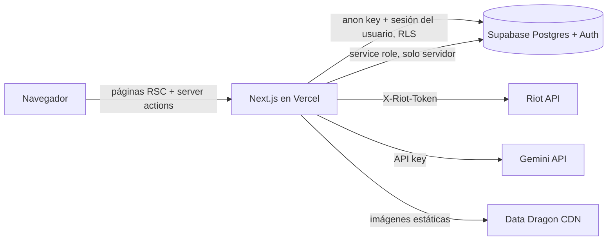

# 02 — Arquitectura

## Vista general


**Idea central:** el navegador **nunca** habla con Riot ni con Gemini. Todo pasa por el servidor de Next, que valida, cachea en Supabase y aplica límites. Las tablas con datos "verificados" solo las escribe el servidor con la service role, así que el jugador no puede tocarlas aunque manipule el cliente.

## Estructura de carpetas
```
src/
  app/
    (auth)/login/page.js
    (auth)/registro/page.js
    onboarding/page.js
    page.js                          # landing → redirige según la intención si hay sesión
    jugadores/page.js                # buscador (filtros + lenguaje natural)
    jugadores/[usuario]/page.js      # perfil público
    perfil/editar/page.js            # datos declarados
    perfil/vincular/page.js          # vincular + verificar Riot ID
    equipos/page.js
    equipos/nuevo/page.js
    equipos/[id]/page.js
    torneos/...                      # P5
    api/
      riot/vincular/route.js         # POST: resuelve el Riot ID y crea la cuenta sin verificar
      riot/verificar/route.js        # POST: compara el ícono
      riot/sincronizar/route.js      # POST: sync con cooldown
      ia/informe/route.js            # POST: informe de scouting
      ia/busqueda/route.js           # POST: lenguaje natural → filtros
  components/
    ui/                              # Button, Card, Badge, Input... (sin lógica)
    perfil/  equipos/  buscador/  torneos/
  lib/
    supabase/client.js server.js admin.js
    riot/client.js regions.js endpoints.js sync.js ddragon.js
    ia/gemini.js informe.js busqueda.js
    stats.js                         # puro, testeable
    compatibilidad.js                # puro, testeable
    horarios.js                      # puro, testeable
    rangos.js                        # orden de tiers, labels en español
  middleware.js
supabase/schema.sql
scripts/seed-demo.mjs
docs/
```

## Convenciones
- Tablas, columnas y textos de la UI en **español**; los identificadores de JS en **inglés** (`syncAccount`, `computeStats`).
- Server Components por defecto; `"use client"` solo donde hay interacción.
- Lecturas: Server Components con el cliente de Supabase del servidor (respeta RLS). Escrituras del usuario: server actions. Escrituras "verificadas": route handlers con `admin.js` (service role).
- Toda respuesta de API tiene la forma `{ ok: true, data }` o `{ ok: false, error: { code, message } }`.
- Las funciones puras (`stats`, `compatibilidad`, `horarios`) no importan nada de Next ni de Supabase, así se pueden testear.
- Roles de LoL: se usan los valores de Riot (`TOP`, `JUNGLE`, `MIDDLE`, `BOTTOM`, `UTILITY`) en la BD y se traducen en la UI (Top, Jungla, Mid, ADC, Support).

## Flujos clave

### Vincular y verificar
```
POST /api/riot/vincular {gameName, tagLine, plataforma}
  → account-v1 by-riot-id → puuid
  → si el puuid ya está verificado por otro usuario → error "cuenta ya vinculada"
  → summoner-v4 → profileIconId actual
  → elige un ícono base (0-28) distinto del actual → guarda cuentas_riot (verificada=false, expira en 15 min)
POST /api/riot/verificar
  → summoner-v4 → si profileIconId == icono_verificacion y no expiró → verificada=true
  → borra los reclamos no verificados del mismo puuid hechos por otros usuarios → dispara el sync
```

### Sincronizar (con caché)
```
POST /api/riot/sincronizar
  → si sincronizado_en < 10 min → devuelve lo cacheado (sin llamar a Riot)
  → league-v4 by-puuid → rango
  → match-v5 ids (queue=420, count=30)
  → filtra los match_id que ya están en `partidas` → pide SOLO los nuevos
  → inserta partidas + partidas_jugador → computeStats() → estadisticas_jugador
```
Las partidas son inmutables, así que se cachean para siempre. Un perfil que se re-sincroniza gasta ~4 requests en lugar de ~33.

### IA
Ver `05-ia-gemini.md`. Resumen: informe = Gemini con JSON schema + caché por hash; búsqueda = Gemini → JSON de filtros → validación con whitelist → query hecha por el código; compatibilidad = algoritmo determinístico (sin LLM).

## Decisiones para defender ante el jurado
| Decisión | Por qué |
|---|---|
| Next.js full-stack (sin backend aparte) | Una sola persona programando: un repo, un deploy. Los route handlers son el backend y las keys quedan en el servidor. |
| Supabase con RLS | Auth + Postgres + permisos en la propia BD. Aunque alguien manipule el front, la BD no le deja escribir sus stats ni ver contactos ocultos. |
| Contacto en una tabla aparte | RLS filtra filas, no columnas. Separar `contactos_jugador` permite que el perfil sea público y el contacto no. |
| Caché de partidas en Postgres | Respeta el rate limit de Riot (leído de los headers de cada respuesta), hace que el perfil cargue rápido y la demo sobreviva aunque la API o la key fallen. |
| Verificación por ícono | Sin production key no hay RSO. El ícono prueba que controlás la cuenta (lo mismo que hacen otras plataformas). RSO queda en el roadmap. |
| El LLM no escribe SQL | Evita la inyección por prompt: el LLM solo propone filtros, que se validan contra una whitelist. |
| Compatibilidad sin LLM | Es explicable, instantánea, gratis y da siempre el mismo resultado. El LLM se usa donde aporta (redactar, interpretar), no para sumar puntajes. |
| JavaScript y no TypeScript | Es el stack que Ian domina; con el tiempo de la hackathon, la velocidad pesa más. La migración a TS está en el roadmap. |

## Preguntas probables del jurado (preparar respuestas)
- ¿Qué pasa si se cae la Riot API o se vence la key en la demo? → caché + `DEMO_MODE`.
- ¿Cómo escala el rate limit con muchos usuarios? → production key, cola de sync en background (cron/queue) y caché inmutable de partidas.
- ¿Cómo evitan que alguien se haga pasar por otro jugador? → verificación por ícono y un índice único sobre el puuid verificado.
- ¿Cómo evitan que el LLM invente stats? → input acotado, salida con schema e instrucción explícita; los números de la UI salen de la BD, no del LLM.
- ¿Por qué se puede confiar en el % de compatibilidad? → fórmula pública con pesos y desglose visible.
