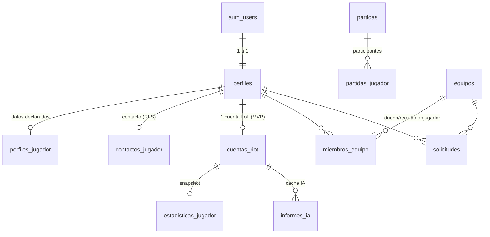

# 03 — Base de datos

SQL completo: **`supabase/schema.sql`** (correrlo una vez en el SQL Editor de un proyecto vacío). Los cambios posteriores van en archivos nuevos (`supabase/torneos.sql`, etc.) y se anotan acá.

## Modelo

`partidas_jugador` se une a `cuentas_riot` por `puuid` (no por FK: guardamos partidas aunque el jugador después desvincule).

## Tablas
| Tabla | Quién escribe | Notas |
|---|---|---|
| `perfiles` | el usuario (en el onboarding) | `nombre_usuario` único, `intencion` solo para la pantalla inicial |
| `perfiles_jugador` | el usuario | datos declarados; `horarios` en JSON con su `zona_horaria` IANA |
| `contactos_jugador` | el usuario | separado para poder ocultarlo con RLS |
| `cuentas_riot` | **servidor** | puuid, verificación, rango. `rango_valor` sirve para filtrar "X+" |
| `partidas` | **servidor** | JSON crudo de match-v5, inmutable |
| `partidas_jugador` | **servidor** | 1 fila por partida y jugador con las métricas ya extraídas |
| `estadisticas_jugador` | **servidor** | resumen calculado que lee el perfil |
| `benchmarks_rango` | seed | promedios estimados por tier (`fuente='estimado'`) |
| `informes_ia` | **servidor** | caché por `(cuenta_id, stats_hash)` |
| `equipos` | dueño/reclutador | al crearlo, un trigger agrega al creador como `dueno` |
| `miembros_equipo` | dueño | el miembro puede salirse solo |
| `solicitudes` | jugador o staff | invitaciones/postulaciones |

## Decisiones
- **`perfiles` no se crea con un trigger** sobre `auth.users`, porque el nombre de usuario lo elige la persona. El middleware manda a `/onboarding` a quien no tiene perfil.
- **Escrituras verificadas solo con service role**: esas tablas no tienen policies de insert/update, así que con la anon key es imposible escribirlas.
- **Índice único parcial `puuid where verificada`**: varios pueden *reclamar* una cuenta, pero solo uno puede *verificarla*. Así nadie bloquea una cuenta ajena reclamándola primero.
- **`horarios` en JSONB y no en una tabla**: siempre se leen completos junto con el perfil y el cálculo es en JS. Más simple para un solo dev; si hiciera falta filtrar por horario en SQL, se normaliza (roadmap).
- **Funciones `security definer`** (`rol_en_equipo`, `es_miembro_de_algun_equipo`): evitan que las policies de `miembros_equipo` se consulten a sí mismas (recursión de RLS).
- **Vista `vista_jugadores` con `security_invoker`**: aplica el RLS de quien consulta y no expone el contacto.

## `rango_valor`
Se calcula en el sync con `src/lib/rangos.js`:
`indexTier * 4 + (4 - divisionNumero)` con `IRON=0 … DIAMOND=6`. MASTER, GRANDMASTER y CHALLENGER no tienen división (`MASTER=28`, `GRANDMASTER=29`, `CHALLENGER=30`). Unranked = `null`.
Ej.: "Esmeralda+" → `rango_valor >= 5*4 = 20`.

## Torneos (P5, T23) — propuesta
```
torneos(id, organizador_id, equipo_organizador_id?, nombre, descripcion, formato, max_equipos,
        premio_monto, moneda, comision_pct, estado, fecha_inicio, ganador_equipo_id,
        pago_ref, creado_en)
  estado: borrador → premio_depositado → publicado → en_curso → finalizado → pagado
inscripciones_torneo(torneo_id, equipo_id, inscrito_en, PK(torneo_id, equipo_id))
```
Los cambios de estado los hace el servidor (route handler) validando la transición, no el cliente.
